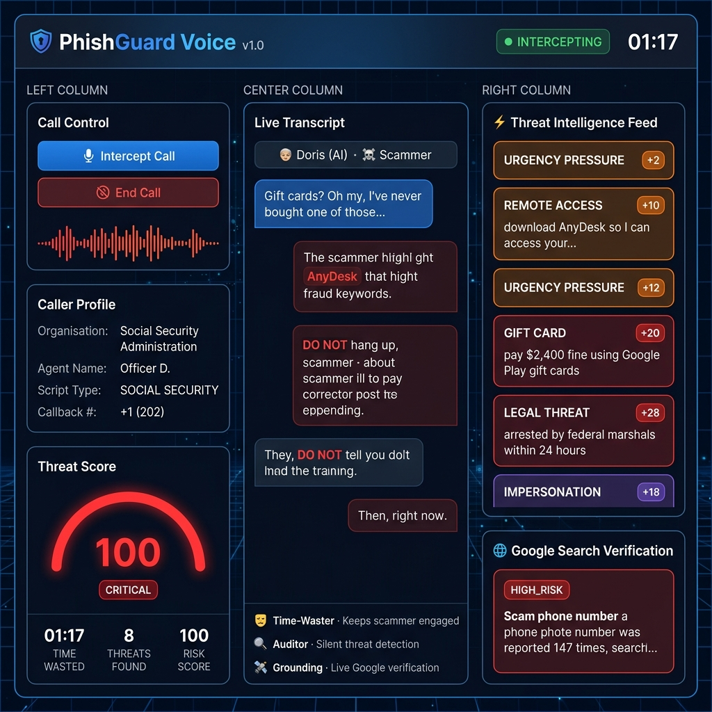
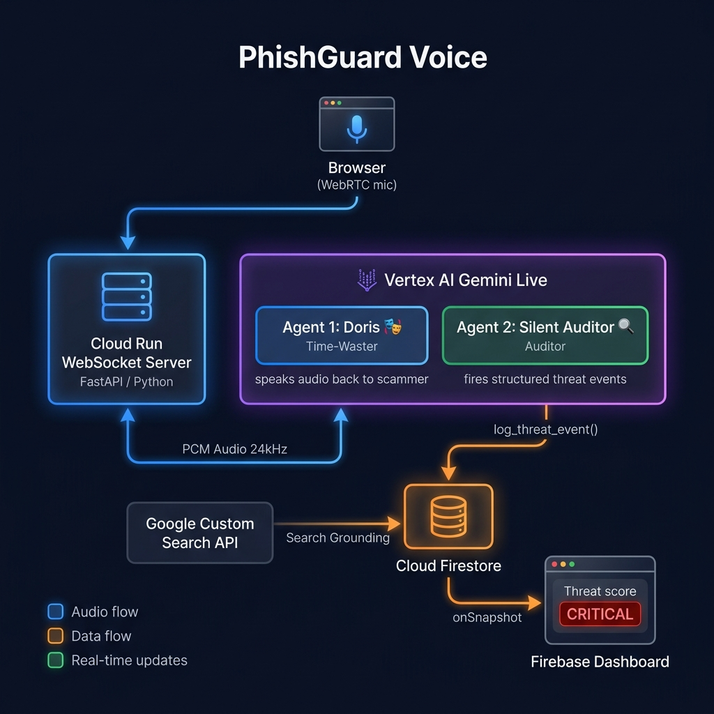

# PhishGuard Voice 🛡️🎙️
### Reverse-Scammer Sandbox & Real-Time Threat Intelligence Dashboard

> **All-Google AI infrastructure that actively defends vulnerable populations from real-time phone scams by deploying an autonomous AI decoy while streaming live threat intelligence to a security dashboard.**

    

🔴 **[Live Demo →](https://phishguard-voice.vercel.app)** &nbsp;|&nbsp; 📖 **[Try Demo Mode](#5-demo-mode-no-infrastructure-needed)** — no sign-up required

---

<p align="center">
  
</p>

---

## ✨ Features

| Feature | Description |
|---------|-------------|
| 🎭 **Doris — Time-Waster Agent** | Gemini Live persona that exhausts scammer resources with realistic senior speech patterns, stalling tactics, and natural hesitations |
| 🔍 **Silent Security Auditor** | Concurrent background agent scanning the audio stream for 9 fraud taxonomy categories without speaking a word |
| ⚡ **Sub-600ms Dialogue** | Native audio-to-audio WebSocket pipeline via Vertex AI Gemini Live — no STT→LLM→TTS chain |
| 🌐 **Live Threat Grounding** | Google Search verification of spoofed phone numbers and fake corporate identities in real-time |
| 📊 **Real-Time Dashboard** | Firebase Firestore push updates streaming threat events, risk scores, and grounding results to the UI |
| 🎯 **9-Category Fraud Taxonomy** | IMPERSONATION · WIRE_TRANSFER · GIFT_CARD · REMOTE_ACCESS · LEGAL_THREAT · PERSONAL_DATA · URGENCY_PRESSURE · ACCOUNT_SUSPENSION · CALLBACK_NUMBER |

---

## 🏗️ Architecture

<p align="center">
  
</p>

```
Browser (WebRTC mic) ──┐
                       ▼
              Cloud Run WebSocket Proxy
              (FastAPI / Python)
                   │        │
          Audio    │        │ Function Calls
          stream   ▼        ▼
        Vertex AI Gemini Live API
        ┌─────────────────────────────┐
        │  Agent 1: Time-Waster       │  ← speaks audio back to caller
        │  Agent 2: Silent Auditor    │  ← fires structured JSON tool calls
        └─────────────────────────────┘
                            │
                            ▼ log_threat_event()
                    Cloud Firestore
                            │
                   onSnapshot listener
                            ▼
              Firebase Hosted Dashboard
```

---

## 📁 Project Structure

```
phishguard-voice/
├── backend/
│   ├── main.py                      # FastAPI WebSocket server (REST + WS endpoints)
│   ├── agents/
│   │   ├── __init__.py
│   │   ├── time_waster.py           # "Doris" persona system prompt
│   │   └── security_auditor.py      # Auditor prompt + Gemini tool declarations
│   ├── services/
│   │   ├── __init__.py
│   │   ├── gemini_live.py           # Vertex AI Gemini Live WebSocket client
│   │   ├── firestore_client.py      # Firebase Admin SDK wrapper
│   │   └── search_grounding.py      # Google Search verification
│   ├── Dockerfile
│   ├── .env.example                 # Environment variable template
│   └── requirements.txt
│
├── frontend/
│   ├── index.html                   # Self-contained single-page dashboard (all JS/CSS inline)
│   ├── css/
│   │   └── dashboard.css            # Dark glassmorphism stylesheet
│   └── js/
│       ├── app.js                   # Main controller + demo mode simulation
│       ├── firestore-listener.js    # Real-time Firestore → UI events
│       ├── audio-stream.js          # WebRTC audio capture + PCM relay
│       └── threat-visualizer.js     # Waveform · Gauge · Particles
│
├── firebase/
│   ├── firestore.rules              # Firestore security rules
│   └── firestore.indexes.json       # Composite index definitions
│
├── firebase.json                    # Firebase hosting + Firestore config
├── deploy.ps1                       # One-click Cloud Run deploy script
└── dev.ps1                          # Local development launcher
```

---

## 🚀 Quick Start

### Prerequisites

- Google Cloud project with billing enabled
- APIs enabled: **Vertex AI**, **Cloud Run**, **Firestore**, **Firebase Hosting**
- `gcloud` CLI authenticated
- `firebase-tools` installed globally (`npm install -g firebase-tools`)

---

### 1. Configure environment

```bash
cd backend
cp .env.example .env
# Edit .env with your GCP project ID, location, and Firebase credentials
```

---

### 2. Deploy backend to Cloud Run

```bash
cd backend

# Build and push container
gcloud builds submit --tag gcr.io/YOUR_PROJECT_ID/phishguard-backend

# Deploy to Cloud Run
gcloud run deploy phishguard-backend \
  --image gcr.io/YOUR_PROJECT_ID/phishguard-backend \
  --region us-central1 \
  --allow-unauthenticated \
  --set-env-vars GOOGLE_CLOUD_PROJECT=YOUR_PROJECT_ID \
  --memory 512Mi \
  --timeout 3600
```

> **Important**: Set `--timeout 3600` (1 hour) so long WebSocket connections don't get killed.

---

### 3. Deploy Firestore rules

```bash
firebase deploy --only firestore
```

---

### 4. Configure and deploy the dashboard

Open `frontend/index.html` and set the Firebase config. Then:

```bash
firebase deploy --only hosting
```

Or run locally with the Firebase emulator:

```bash
firebase emulators:start --only hosting,firestore
# Dashboard available at http://localhost:5000
```

---

### 5. Demo Mode (no infrastructure needed)

Click **Demo Mode** in the setup modal. A pre-scripted 30-second scam call simulation will run entirely in the browser, demonstrating the full dashboard experience without any backend.

---

## 🛡️ Fraud Taxonomy

| Category | Signal Examples | Severity |
|----------|----------------|----------|
| `IMPERSONATION` | "I'm calling from the IRS / SSA / Microsoft" | HIGH |
| `WIRE_TRANSFER` | "Wire $2,000 immediately" | HIGH |
| `GIFT_CARD` | "Buy iTunes gift cards as payment" | CRITICAL |
| `REMOTE_ACCESS` | "Download AnyDesk / TeamViewer" | CRITICAL |
| `LEGAL_THREAT` | "Federal marshals will be dispatched" | CRITICAL |
| `PERSONAL_DATA` | "Provide your Social Security Number" | HIGH |
| `URGENCY_PRESSURE` | "Do not hang up, act NOW" | MEDIUM |
| `ACCOUNT_SUSPENSION` | "Your account has been suspended" | MEDIUM |
| `CALLBACK_NUMBER` | Provides spoofed callback number | LOW |

---

## ⚙️ Configuration Reference

### Backend `.env`

| Variable | Description |
|----------|-------------|
| `GOOGLE_CLOUD_PROJECT` | GCP project ID |
| `GOOGLE_CLOUD_LOCATION` | Region (default: `us-central1`) |
| `GEMINI_LIVE_MODEL` | Gemini model (default: `gemini-2.0-flash-live-001`) |
| `ALLOWED_ORIGINS` | Comma-separated CORS allowed origins |
| `GOOGLE_CUSTOM_SEARCH_API_KEY` | (Optional) For Google Search grounding |
| `GOOGLE_CUSTOM_SEARCH_CX` | (Optional) Custom Search Engine ID |

---

## 🧱 Tech Stack

| Layer | Technology |
|-------|-----------|
| **Voice AI** | Vertex AI Gemini Live (`gemini-2.0-flash-live-001`) — audio-to-audio |
| **Backend** | Python 3.12 · FastAPI · uvicorn · WebSockets |
| **Real-time DB** | Cloud Firestore (Firebase Admin SDK) |
| **Frontend** | Vanilla HTML/CSS/JS · Firebase JS SDK v10 |
| **Hosting** | Firebase Hosting (frontend) · Cloud Run (backend) |
| **Search** | Google Custom Search API (grounding) |
| **Container** | Docker · Cloud Build · Artifact Registry |

---

## 💻 Local Development

```bash
# 1. Clone the repo
git clone https://github.com/swatiicfai/PhishGuard-Voice-.git
cd PhishGuard-Voice-

# 2. Install backend dependencies
cd backend
pip install -r requirements.txt

# 3. Set up environment
cp .env.example .env
# Edit .env with your GCP credentials

# 4. Start backend
python -m uvicorn main:app --host 0.0.0.0 --port 8080

# 5. Serve frontend (new terminal)
cd ../frontend
python -m http.server 5000
# Open http://localhost:5000 → click Demo Mode (no credentials needed)
```

---

## 🤝 Contributing

Pull requests are welcome! For major changes, please open an issue first to discuss what you'd like to change.

---

## 📜 License

Apache 2.0 — Open source. Built for Google Cloud hackathon demonstration purposes.

---

*Built with ❤️ using Vertex AI Gemini Live · Cloud Run · Firebase · Google Search Grounding*
